# Mini-projet 1 : application web à deux niveaux sur k3s

Déploiement déclaratif d'un **frontend** (nginx) et d'une **API** (podinfo) sur un cluster k3s à 3 nœuds,
exposés par un Ingress Traefik, avec mise à jour sans coupure, rollback et diagnostic de pannes.

## 1. Architecture

```
                 Utilisateur
                     |
              Ingress (Traefik)
        web.k3s.local | api.k3s.local
              /                 \
   Service frontend-svc     Service api-svc
        (ClusterIP)           (ClusterIP)
             |                     |
   Deployment frontend       Deployment api
 (2 réplicas, nginx:alpine) (3 réplicas, podinfo:6.5.4)
```

| Élément | Valeur |
|---|---|
| Cluster | k3s v1.36, 1 serveur (`wissal`) + 2 agents (`k3s-agent1`, `k3s-agent2`) |
| Namespace | `projet1` |
| Frontend | `nginx:alpine`, 2 réplicas, labels `app=frontend, tier=frontend` |
| API | `ghcr.io/stefanprodan/podinfo:6.5.4`, 3 réplicas, labels `app=api, tier=backend` |
| Ingress | `projet1-ingress`, classe `traefik` |

## 2. Prérequis

- 3 VMs Ubuntu Server avec k3s (1 serveur, 2 agents) et `kubectl` sur le serveur
- Poste Windows avec `curl.exe`
- Fichier `C:\Windows\System32\drivers\etc\hosts` : `<IP_NOEUD>  web.k3s.local api.k3s.local`

## 3. Déploiement

```bash
kubectl apply -f manifests/
kubectl config set-context --current --namespace=projet1
kubectl get all
kubectl get ingress
```

## 4. Contenu de `manifests/`

| Fichier | Rôle |
|---|---|
| `00-namespace.yaml` | Namespace `projet1` |
| `10-api-deployment.yaml` | API : 3 réplicas, `podinfo:6.5.4` |
| `20-frontend-deployment.yaml` | Frontend : 2 réplicas, `nginx:alpine` |
| `30-api-service.yaml` | Service ClusterIP `api-svc` |
| `31-frontend-service.yaml` | Service ClusterIP `frontend-svc` |
| `40-ingress.yaml` | Ingress `web.k3s.local` et `api.k3s.local` |

## 5. Étapes, résultats et réponses

### Étape 0 : namespace (E1, E8)

Le namespace `projet1` est créé depuis un fichier YAML versionné.

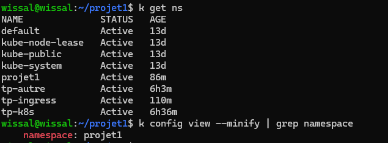

**Pourquoi isoler un projet dans un namespace ?** Les noms de ressources sont indépendants entre projets, la suppression se fait en une commande, on peut y appliquer des quotas et des droits, et `kubectl get all` ne montre que le projet.

### Étapes 1 et 2 : Deployments (E2, E3, E4)

3 Pods d'API et 2 Pods de frontend, avec des labels `app` et `tier` distincts. L'image de l'API a une version explicite (pas de `latest`).

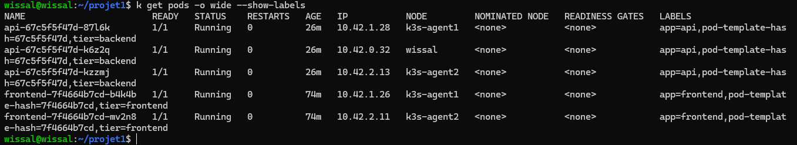
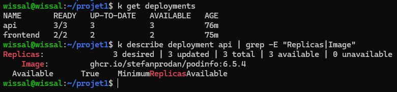

**Sur quels nœuds les Pods sont-ils répartis, et qui a décidé ?** Les Pods sont répartis sur les 3 nœuds. La décision vient du **scheduler** (kube-scheduler), selon les ressources disponibles.

**Que se passerait-il avec les mêmes labels ?** Chaque ReplicaSet sélectionnerait aussi les Pods de l'autre : conflit de propriété, nombre de Pods incohérent, et un Service enverrait du trafic vers un mélange d'API et de frontend.

### Étape 3 : Services et DNS (E5, E6)

Deux Services ClusterIP. Les endpoints correspondent aux IP des Pods : 3 pour l'API (port 9898), 2 pour le frontend (port 80).

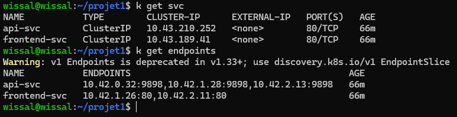

Depuis un Pod du frontend, l'API est jointe par son nom DNS. `nslookup` renvoie la CLUSTER-IP via CoreDNS. Les lignes `NXDOMAIN` sont normales : le Pod essaie d'autres suffixes de recherche qui n'existent pas.

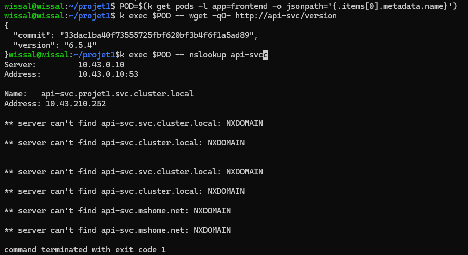

**Nom DNS complet d'un Service :** `<service>.<namespace>.svc.cluster.local`, ici `api-svc.projet1.svc.cluster.local`.

**Que renvoie `get endpoints` et pourquoi est-ce utile ?** La liste des IP:port des Pods prêts qui correspondent au sélecteur. Un résultat `<none>` révèle immédiatement un sélecteur erroné ou des Pods absents.

### Étape 4 : Ingress (E7)

Un seul Ingress, deux règles par hôte, géré par Traefik.

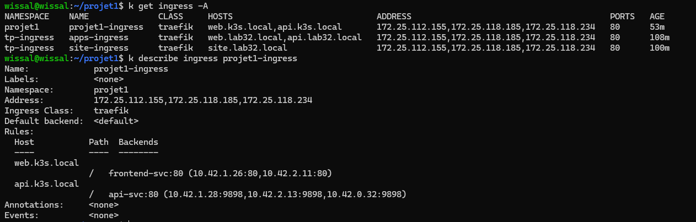
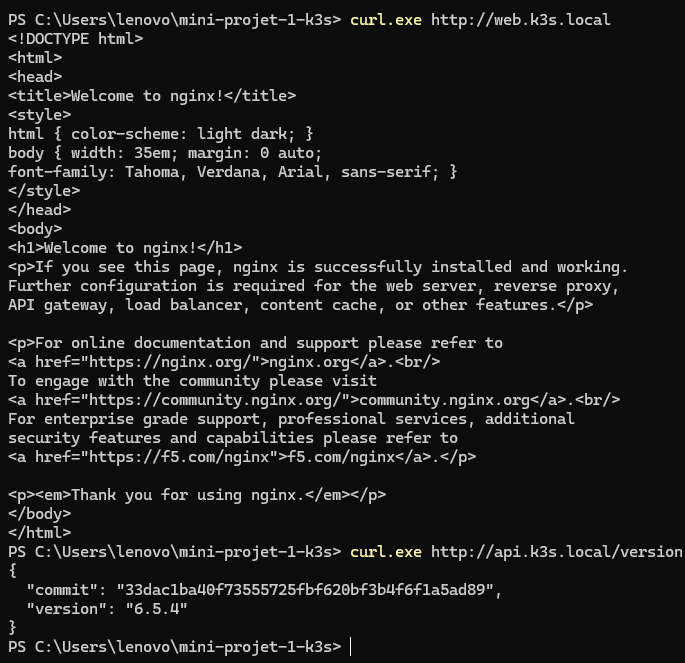
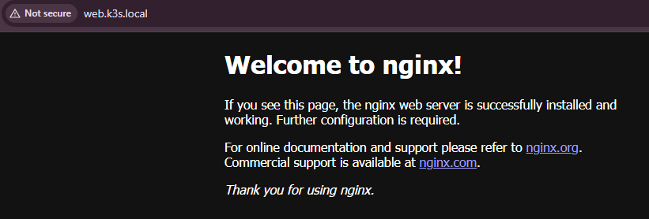

**Pourquoi un Ingress plutôt que deux NodePort ?** Un point d'entrée unique (ports 80 et 443), des noms lisibles, du routage par hôte et par chemin. Les NodePort demandent un port élevé par application, sans routage par nom.

### Étape 5 : mise à jour sans coupure et rollback (E9)

L'image de l'API passe de `6.5.4` à `6.6.0` en modifiant le manifeste puis en appliquant.

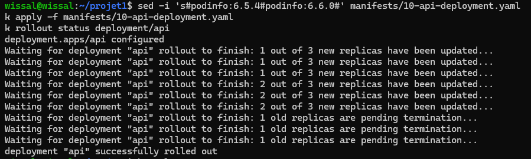
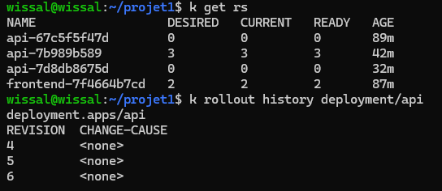
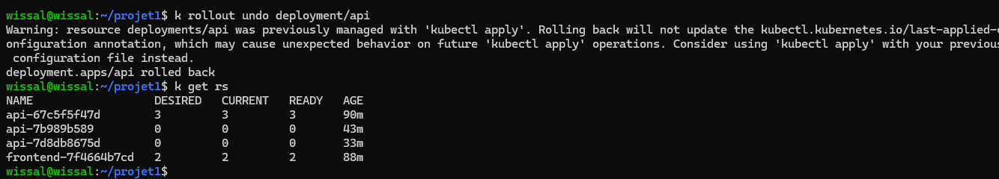

**Combien de ReplicaSets après la mise à jour, et pourquoi l'ancien est-il conservé ?** Deux : le nouveau (3 Pods) et l'ancien (0 Pod). L'ancien est conservé pour permettre un rollback immédiat (limité par `revisionHistoryLimit`, 10 par défaut).

**Commande de retour arrière :** `kubectl rollout undo deployment/api` (ou `--to-revision=N`).

**Pourquoi pas de coupure ?** La stratégie `RollingUpdate` (25 % max surge, 25 % max unavailable) crée de nouveaux Pods avant de supprimer les anciens, et le Service n'envoie du trafic qu'aux Pods prêts.

### Étape 6 : pannes et diagnostic (E10)

**Panne A : tag d'image inexistant (`6.5.99`)**

| Rubrique | Contenu |
|---|---|
| Symptômes | Un Pod en `ImagePullBackOff`, `rollout status` bloqué à `1 out of 3`, 3 anciens Pods toujours `Running` |
| Investigation | `get pods`, puis `describe pod` / `get events` (`not found`), puis `get rs` et `rollout status` |
| Cause racine | Le tag `ghcr.io/stefanprodan/podinfo:6.5.99` n'existe pas dans le registre |
| Correction | Tag remis à `6.5.4` dans le manifeste, puis `kubectl apply` |

Le service est resté disponible : le rolling update ne supprime les anciens Pods qu'une fois les nouveaux prêts. Les logs sont inutiles pour une erreur de pull, car le conteneur n'a jamais démarré.

**Panne B : sélecteur de Service erroné (`app=apii`)**

| Rubrique | Contenu |
|---|---|
| Symptôme | `curl` renvoie `no available server` (texte court de Traefik) |
| Investigation | `get pods` : 3 Pods sains, puis `get endpoints` : `api-svc <none>`, puis `describe svc` : `Selector: app=apii` |
| Cause racine | Faute dans le `selector` du Service : aucun Pod ne correspond |
| Correction | `app: api` dans le manifeste, puis `kubectl apply` |

### État final

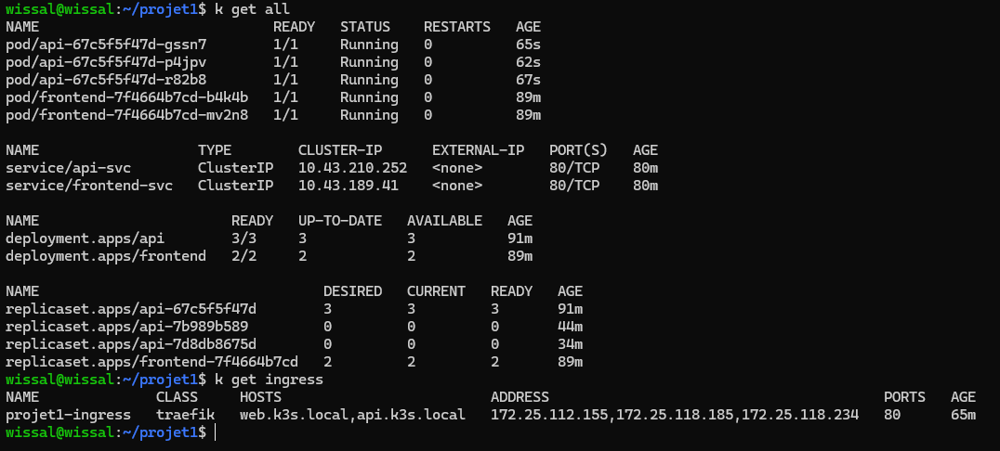

## 6. Exigences

| Exigence | Statut | Preuve |
|---|---|---|
| E1 Namespace dédié | Fait | `00-namespace.png` |
| E2 API 3 réplicas, version explicite | Fait | `01-deployments.png` |
| E3 Frontend 2 réplicas | Fait | `01-deployments.png` |
| E4 Labels `app` et `tier` | Fait | `01-pods.png` |
| E5 Services ClusterIP | Fait | `03-services.png` |
| E6 DNS depuis le frontend | Fait | `03-dns-exec.png` |
| E7 Ingress | Fait | `04-ingress.png`, `04-curl-hosts.png`, `04-navigateur.png` |
| E8 Manifestes dans Git | Fait | dossier `manifests/` |
| E9 Mise à jour sans coupure | Fait | `05-rollout.png`, `05-rs.png`, `05-rollback.png` |
| E10 Panne diagnostiquée | Fait | tableaux des pannes A et B (étape 6) |

## 7. Difficultés rencontrées et enseignements

- **Agent k3s installé en mode serveur** : sans `K3S_URL` et `K3S_TOKEN`, le script installe un serveur. Il faut ces deux variables pour un agent.
- **Mauvaise adresse du serveur** : `192.168.x.x` au lieu de `172.25.x.x`. Les agents expiraient en `context deadline exceeded`. Toujours relever l'IP avec `ip -4 addr` avant d'installer.
- **Téléchargements d'images lents** : Pods longtemps en `ContainerCreating`. Solution : `crictl pull` sur chaque nœud avant les mises à jour.
- **Conflit de noms d'hôte** entre deux Ingress : les hôtes d'un ancien lab ont été renommés (`lab32.local`).
- **Panne réelle du sélecteur** : `apii` dans le Service, trouvée via `get endpoints`.
- **Rollback et déclaratif** : `rollout undo` ne modifie pas le fichier YAML ; il faut le resynchroniser pour que le dépôt reste fidèle au cluster.
- **Amélioration possible** : ajouter une `readinessProbe` et des `resources.requests/limits` pour fiabiliser les mises à jour.
